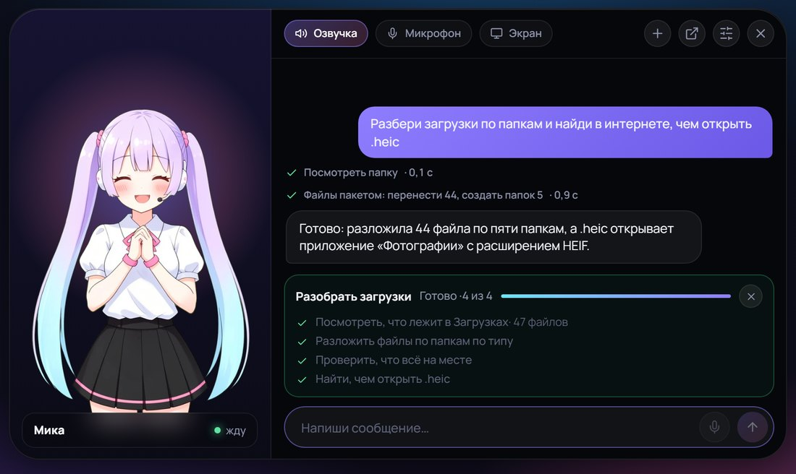
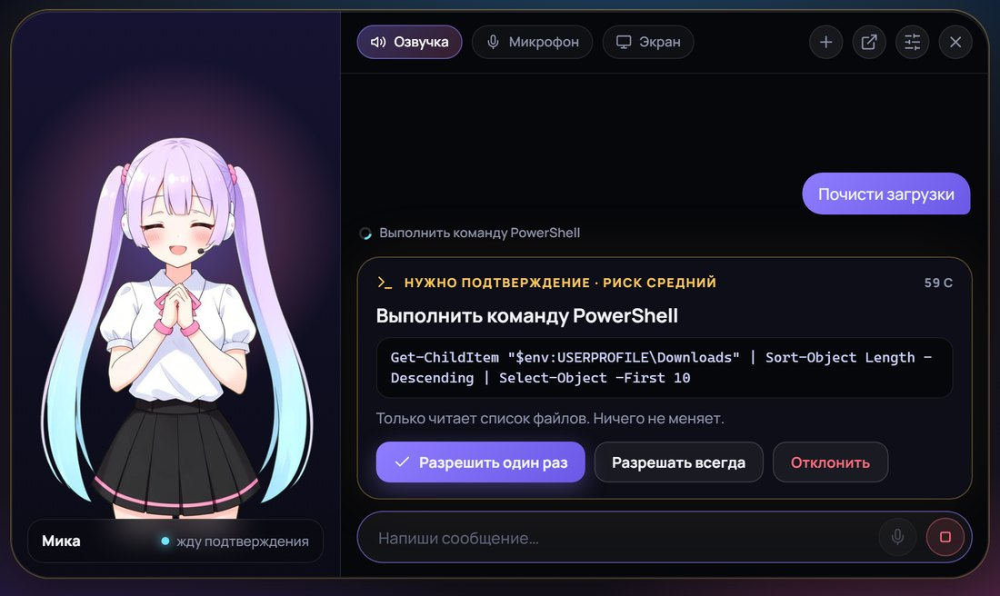
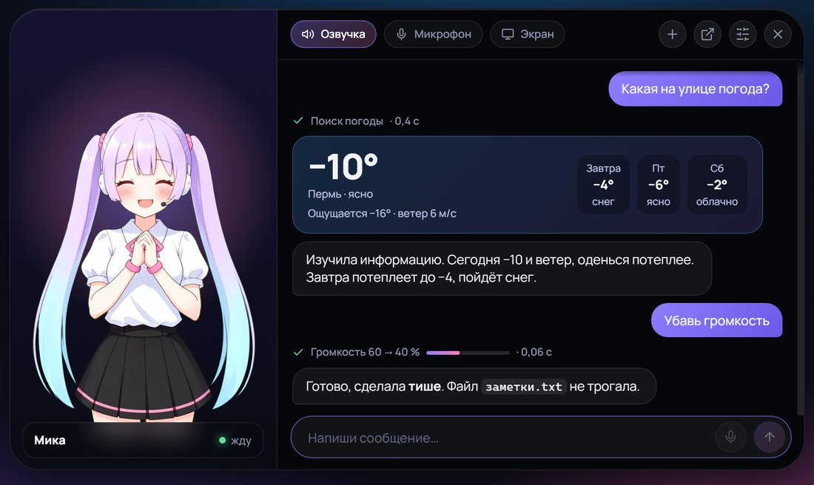
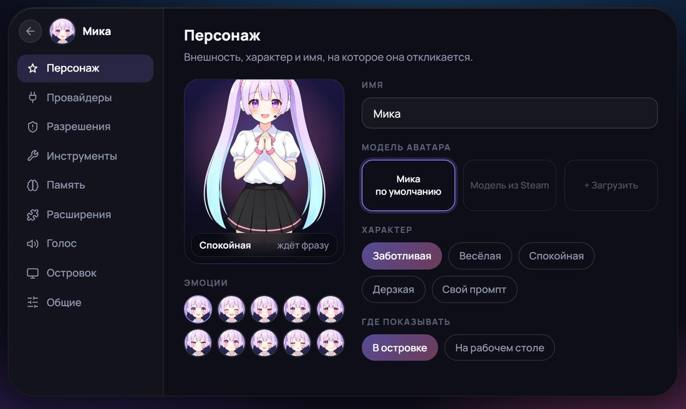
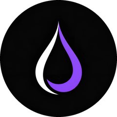

<p align="center">
  
</p>

<h1 align="center">Mika</h1>

<p align="center">
  An AI assistant for Windows: an island at the top of the screen, chat and voice, an anime avatar with emotions,<br>
  system actions only through a risk policy, any OpenAI-compatible provider.
</p>

<p align="center">
  <a href="https://github.com/Artem936c/Mika/releases"></a>
  <a href="https://github.com/Artem936c/Mika/actions/workflows/ci.yml"></a>
  <a href="LICENSE"></a>
  
  
</p>

<p align="center"><a href="README.md">Русский</a> · <b>English</b></p>



The interface is in Russian and English: pick the language on the first-run screen or later on the General page. With the English interface Mika answers in the language you write in; confirmation cards, tool lines and some errors are still in Russian. The screenshots show the Russian interface.

## What she can do

- **An island at the top of the screen.** When folded, it shows her state, a reply, the weather, the current track and reminders. A click or Ctrl+Alt+M opens the chat.
- **A window.** Tear the island off into an ordinary window and drag it to another monitor. Behind a game or a full-screen video the island steps back.
- **Tasks in several steps.** Mika makes a plan, checks every step and shows progress in the chat. The Stop button ends the task.
- **Windows of any program.** She reads a window, clicks buttons by their label or by a path, types text and presses keys. After every action she sees what changed.
- **Her own browser** in a separate Edge profile: open, read, click, fill in. She leaves sign-in, banking and payment pages alone.
- **Files**: search, read, write, archives, the Recycle Bin. Tidying a folder takes up to 200 actions under one confirmation.
- **Memory** with search by meaning, an archive of past conversations, reminders, timers, scheduled tasks, a to-do list.
- **Screen**: a question about a screenshot, text from a picture, a screenshot.
- **Information and system**: weather, exchange rates, news, the media player, volume, Wi-Fi, Bluetooth, brightness.
- **Voice.**
  - Speech with a Windows voice or a provider's voice, input from the microphone.
  - The wake phrase "Mika" is recognized on this computer, by sherpa-onnx, Vosk or the Windows recognizer: you pick which in the settings.
  - Actions can be confirmed by voice.
  - "Stop" (in Russian: «стоп», «стой», «хватит», «перестань слушать») stops everything at any moment: the reply, the task, actions in windows, background jobs. After that Mika starts nothing on her own until you call her.
- **Settings by conversation.** "Speak quieter", "change the voice", "turn off dictation", "what are your settings?". The microphone, the screen, Telegram and other sensitive features turn on only with a confirmation. The microphone and the screen cannot be turned on from Telegram.
- **Skills.** After a successful chain of actions Mika offers to save it as a skill, then repeats it by name, with parameters. Every step of a skill goes through the risk policy again.
- **Extensions**: MCP servers (a program or HTTP), your own commands, control from Telegram.
- **Avatar.** An original character with ten emotions. She blinks, looks around, talks and reacts to clicks. The core picks her emotion from her state and from tags in the model's reply.
- **Your own 3D model.** Add a `.vrm` file on the Character page and Mika comes alive in it:
  - she breathes, blinks, shifts her weight and stands in one of five poses;
  - her lips move with her voice and her body answers her emotions;
  - she looks at the cursor and the input field and reacts to clicks on her head, hands and body;
  - she plays your `.vrma` animations and gestures on request.

  On the desktop you drag the model with the mouse and resize it with the wheel.

<table>
  <tr>
    <td></td>
    <td></td>
  </tr>
  <tr>
    <td align="center">Every action goes through a confirmation with a risk level</td>
    <td align="center">Replies with cards</td>
  </tr>
</table>




## Safety

- **Risk policy.** Every tool is registered with a risk level and runs only through the policy. Without a saved rule Mika asks first. High-risk actions can never be allowed forever. Commands that only look at system information can be allowed with one rule; reading files, the clipboard and anything with passwords or keys still asks.
- **Blind zone.** Windows and pages with passwords, sign-in, banking and payment are never read or controlled: the tool checks this before any action.
- **Keys** for providers live in the Windows Credential Manager and never reach the settings file, the log or error texts.
- **Off by default.** Internet tools, screen viewing and the microphone stay off until you turn them on.
- **MCP and Telegram.** MCP server tools and Telegram commands go through the same policy.

Found a security problem? See [SECURITY.md](SECURITY.md).

## Installation

1. Download the installer from [Releases](https://github.com/Artem936c/Mika/releases) and run it. No administrator rights are needed.
   - The installer is not signed, so SmartScreen may warn you. Click "More info" → "Run anyway".
2. On the first-run screen pick a provider and what Mika is allowed to do.
3. Models are chosen from the provider's list, with prices and descriptions.

An inexpensive set on [RouterAI](https://routerai.ru) (`https://routerai.ru/api/v1`):

| Task | Model |
|---|---|
| Main and vision | `google/gemma-4-26b-a4b-it` |
| Search by meaning | `perplexity/pplx-embed-v1-0.6b` |
| Images | `black-forest-labs/flux.2-klein-4b` |
| Speech synthesis | `google/gemini-3.8-flash-lite-tts`, voice `Kore` |
| Speech recognition | `qwen/qwen3-asr-0.6b` |

OpenAI, Anthropic, Ollama and any OpenAI-compatible server work too.

**Updates from the app.** On the General page enter:

```
https://raw.githubusercontent.com/Artem936c/Mika/main/updates/latest.json
```

The installer is downloaded only when you press the button and installed only if its checksum matches. `updates/latest.json` in this repository always points to the latest release.

## Building from source

| What | Install |
|---|---|
| Rust stable | `winget install Rustlang.Rustup` |
| MSVC Build Tools 2022 | `winget install Microsoft.VisualStudio.2022.BuildTools` |
| Node.js 24 | `winget install OpenJS.NodeJS` |
| WebView2 Runtime | ships with Windows 11 |

```
npm --prefix frontend ci
npm --prefix frontend run build
cd crates/mika-gui
npx @tauri-apps/cli@2 dev      # or cargo tauri dev
```

Installer: `npx @tauri-apps/cli@2 build` from `crates/mika-gui`; the result lands in `target/release/bundle/nsis/`.

Checks:

```
cargo fmt --all --check
cargo clippy --workspace --all-targets -- -D warnings
cargo test --workspace
npm --prefix frontend test
npm --prefix frontend run check
```

**Interface preview without Tauri.** Run `npm --prefix frontend run dev` and open `http://localhost:5173/?mock=chat`. Other scenarios: `task`, `cards`, `reminder`, `confirm`, `high`, `speak`, `settings&page=voice`.

**Terminal client for debugging the core:** `cargo run -p mika-cli`. Commands: `provider`, `key`, `model`, `web`, `mic`, `status`, `probe`, `voices`, `say`, `hear`.

**Where the data lives:**

- settings, history and memory — `%APPDATA%\Mika` (the `MIKA_DATA_DIR` variable moves it);
- the log — `%LOCALAPPDATA%\Mika\logs`;
- keys — the Credential Manager, entries named `Mika`.

## Architecture

| Crate | Purpose |
|---|---|
| `mika-core` | Event bus, agent, risk policy, emotions, memory, scheduler, tasks |
| `mika-providers` | LLM, embeddings, vision, images, speech, model catalog, MCP, Telegram |
| `mika-audio` | Speech output, microphone recording, wake phrase |
| `mika-tools` | Windows tools: windows, files, browser, screen, system |
| `mika-cli` | Terminal client |
| `mika-gui` | Tauri 2 app; the Svelte interface lives in `frontend/` |

Release notes (in Russian) are in [docs/releases](docs/releases/).

## Not there yet

- A built-in 3D model: without your own `.vrm` file the avatar is drawn with pictures.
- Live2D models: they need a Cubism SDK license.
- A signed installer.

## More from the author

<table>
  <tr>
    <td width="120" align="center">
      <a href="https://bloodsurf.ru"></a>
    </td>
    <td>
      <b>Blood Surface</b> — a VPN from the author of Mika.<br>
      Sign up or renew in the Telegram bot or on the website.<br><br>
      <a href="https://bloodsurf.ru"></a>
      <a href="https://t.me/bloodvpn_bot"></a>
    </td>
  </tr>
</table>

## License

[MIT](LICENSE). The character is original. The avatar pictures were generated by FLUX.2 klein from a text description.
