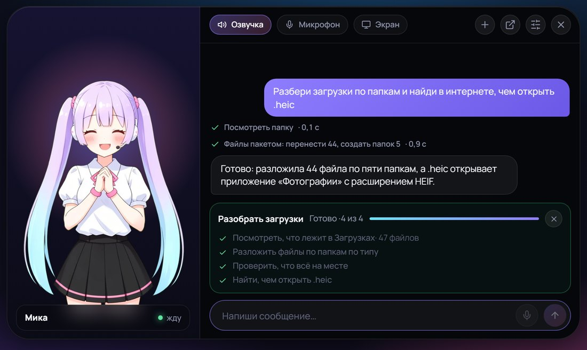
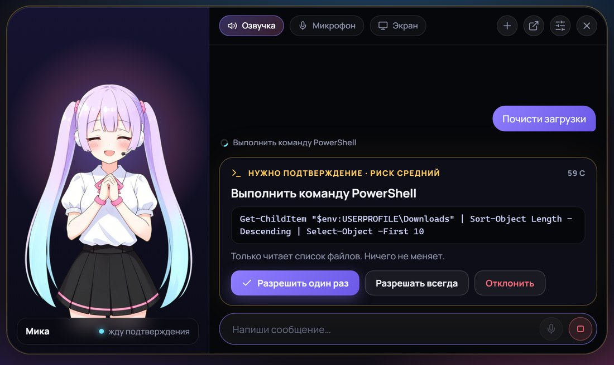
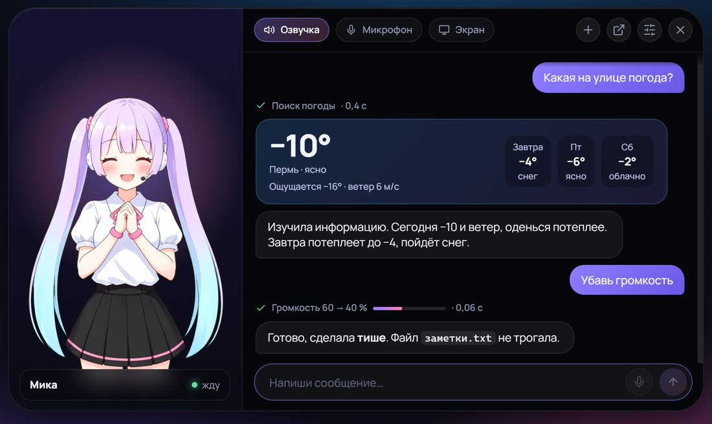
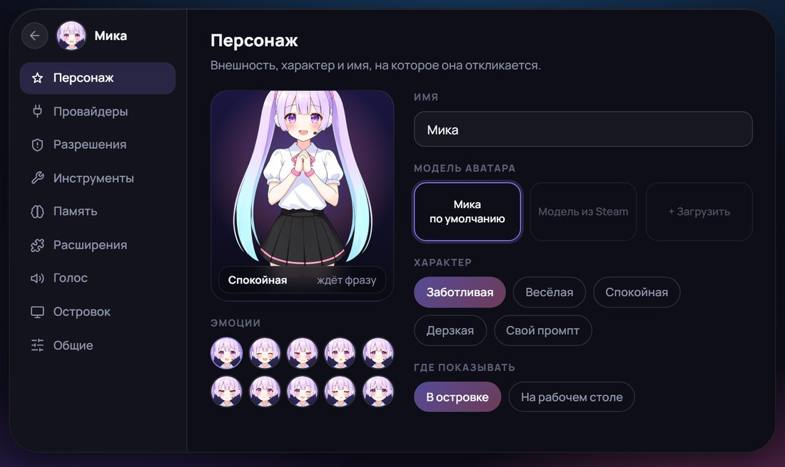

<p align="center">
  
</p>

<h1 align="center">Мика</h1>

<p align="center">
  ИИ-помощница для Windows: островок вверху экрана, чат и голос, аниме-аватар с эмоциями,<br>
  действия в системе только через политику рисков, любой OpenAI-совместимый провайдер.
</p>

<p align="center">
  <a href="https://github.com/Artem936c/Mika/releases"></a>
  <a href="https://github.com/Artem936c/Mika/actions/workflows/ci.yml"></a>
  <a href="LICENSE"></a>
  
  
</p>



## Что она умеет

- **Островок вверху экрана.** Свёрнутый островок показывает состояние, ответ, погоду, трек и напоминания. Щелчок или Ctrl+Alt+M открывает чат.
- **Окно.** Его можно оторвать в обычное окно и перетащить на другой монитор. За игрой и видео на весь экран островок уходит назад.
- **Задачи в несколько шагов.** Мика составляет план, проверяет каждый шаг и показывает ход в чате. Кнопка «Стоп» прерывает задачу.
- **Окна любых программ.** Она читает окно, нажимает кнопки по подписи или цепочкой, вводит текст, нажимает клавиши. После каждого действия видит, что изменилось.
- **Свой браузер** в отдельном профиле Edge: открыть, прочитать, нажать, заполнить. Страницы входа, банков и оплаты она не трогает.
- **Файлы**: поиск, чтение, запись, архивы, корзина. Разбор папки — до 200 действий одним подтверждением.
- **Память** с поиском по смыслу, архив прошлых разговоров, напоминания, таймеры, задачи по расписанию, список дел.
- **Экран**: вопрос по снимку, текст с картинки, снимок.
- **Сведения и система**: погода, курсы, новости, плеер, громкость, Wi-Fi, Bluetooth, яркость.
- **Голос.**
  - Озвучка голосом Windows или провайдера, ввод с микрофона.
  - Активационная фраза «Мика» распознаётся на этом компьютере.
  - Подтверждение действия голосом.
- **Расширения**: серверы MCP (программа или HTTP), свои команды, управление из Telegram.
- **Аватар.** Оригинальный персонаж с десятью эмоциями. Она моргает, оглядывается, говорит и реагирует на клики. Эмоцию выбирает ядро по состоянию и меткам в ответе модели.

<table>
  <tr>
    <td></td>
    <td></td>
  </tr>
  <tr>
    <td align="center">Каждое действие — через подтверждение с уровнем риска</td>
    <td align="center">Ответы с карточками</td>
  </tr>
</table>




## Безопасность

- **Политика рисков.** Каждый инструмент зарегистрирован с уровнем риска и выполняется только через неё. Без сохранённого правила Мика спрашивает. Действия высокого риска нельзя разрешить навсегда.
- **Слепая зона.** Окна и страницы с паролями, входом, банком и оплатой не читаются и не управляются: проверка идёт в инструменте до любого действия.
- **Ключи** провайдеров хранятся в «Диспетчере учётных данных» Windows и не попадают в настройки, журнал и тексты ошибок.
- **Выключено по умолчанию.** Интернет-инструменты, просмотр экрана и микрофон выключены, пока ты их не включишь.
- **MCP и Telegram.** Инструменты серверов MCP и команды из Telegram проходят ту же политику.

## Установка

1. Скачать установщик из [релизов](https://github.com/Artem936c/Mika/releases) и запустить. Права администратора не нужны.
   - Установщик не подписан, поэтому SmartScreen может предупредить. Нажми «Подробнее» → «Выполнить в любом случае».
2. На экране первого запуска выбрать провайдера и то, что Мике можно.
3. Модели выбираются из списка провайдера, с ценой и описанием.

Пример недорогого набора на [RouterAI](https://routerai.ru) (`https://routerai.ru/api/v1`):

| Задача | Модель |
|---|---|
| Основная и зрение | `google/gemma-4-26b-a4b-it` |
| Поиск по смыслу | `perplexity/pplx-embed-v1-0.6b` |
| Картинки | `black-forest-labs/flux.2-klein-4b` |
| Синтез речи | `google/gemini-3.8-flash-lite-tts`, голос `Kore` |
| Распознавание | `qwen/qwen3-asr-0.6b` |

Подойдут и OpenAI, Anthropic, Ollama и любой OpenAI-совместимый сервер.

**Обновления из приложения.** На странице «Общие» указать адрес:

```
https://raw.githubusercontent.com/Artem936c/Mika/main/updates/latest.json
```

Установщик скачивается только по кнопке и ставится, только если совпала контрольная сумма. Файл `updates/latest.json` в этом репозитории всегда указывает на последний выпуск; приложение читает его без входа, только пока репозиторий публичный.

## Сборка из исходников

| Что | Установка |
|---|---|
| Rust stable | `winget install Rustlang.Rustup` |
| MSVC Build Tools 2022 | `winget install Microsoft.VisualStudio.2022.BuildTools` |
| Node.js 24 | `winget install OpenJS.NodeJS` |
| WebView2 Runtime | входит в Windows 11 |

```
npm --prefix frontend ci
npm --prefix frontend run build
cd crates/mika-gui
npx @tauri-apps/cli@2 dev      # или cargo tauri dev
```

Установщик: `npx @tauri-apps/cli@2 build` из `crates/mika-gui`, результат — в `target/release/bundle/nsis/`.

Проверки:

```
cargo fmt --all --check
cargo clippy --workspace --all-targets -- -D warnings
cargo test --workspace
npm --prefix frontend test
npm --prefix frontend run check
```

**Предпросмотр интерфейса без Tauri.** Запустить `npm --prefix frontend run dev` и открыть `http://localhost:5173/?mock=chat`. Другие сценарии: `task`, `cards`, `reminder`, `confirm`, `high`, `speak`, `settings&page=voice`.

**Терминальный клиент для отладки ядра:** `cargo run -p mika-cli`. Команды: `provider`, `key`, `model`, `web`, `mic`, `status`, `probe`, `voices`, `say`, `hear`.

**Где данные:**

- настройки, история и память — `%APPDATA%\Mika` (папку меняет переменная `MIKA_DATA_DIR`);
- журнал — `%LOCALAPPDATA%\Mika\logs`;
- ключи — «Диспетчер учётных данных», записи `Mika`.

## Устройство

| Крейт | Назначение |
|---|---|
| `mika-core` | Шина событий, агент, политика рисков, эмоции, память, планировщик, задачи |
| `mika-providers` | LLM, эмбеддинги, зрение, картинки, речь, каталог моделей, MCP, Telegram |
| `mika-audio` | Озвучка, запись с микрофона, активационная фраза |
| `mika-tools` | Инструменты Windows: окна, файлы, браузер, экран, система |
| `mika-cli` | Терминальный клиент |
| `mika-gui` | Приложение Tauri 2; интерфейс на Svelte в `frontend/` |

Что менялось от выпуска к выпуску — в [заметках к выпускам](docs/releases/).

## Чего ещё нет

- Модель Live2D: нужны лицензия Cubism SDK и сама модель.
- Подпись установщика сертификатом.

## Ещё от автора

<table>
  <tr>
    <td width="120" align="center">
      <a href="https://bloodsurf.ru"></a>
    </td>
    <td>
      <b>Blood Surface</b> — VPN от автора Мики.<br>
      Подключить или продлить можно в Telegram-боте или на сайте.<br><br>
      <a href="https://bloodsurf.ru"></a>
      <a href="https://t.me/bloodvpn_bot"></a>
    </td>
  </tr>
</table>

## Лицензия

[MIT](LICENSE). Персонаж оригинальный. Картинки аватара сгенерированы моделью FLUX.2 klein по текстовому описанию.
